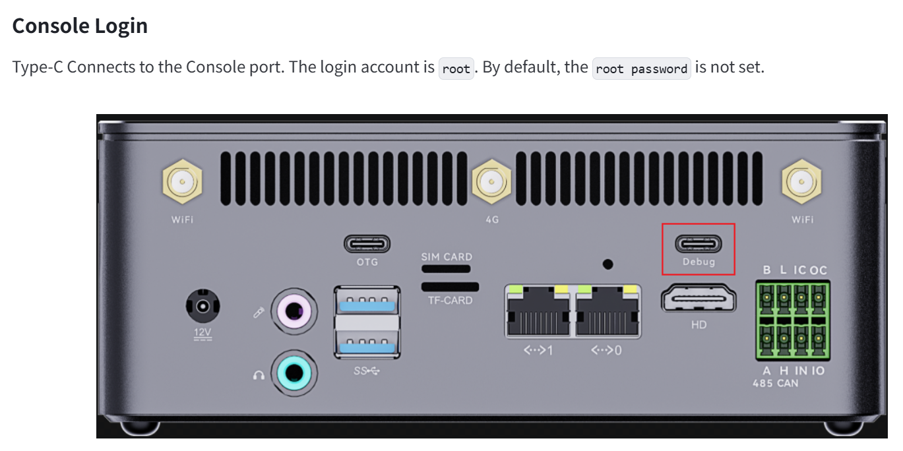

# x86 Ubuntu 仿真 + AiBOX Robonix 完整部署流程

<div class="procedure-meta">
  <div><strong>目标平台</strong>x86_64（Ubuntu 22.04）+ aarch64（Ubuntu 22.04，Firefly AIBOX PRO，RK1828）</div>
  <div><strong>运行方式</strong>两台机器经 IP 互联（局域网或虚拟组网均可）：x86 跑 Webots 仿真与设备驱动，AiBOX 跑 Robonix 大脑、mapping/nav2/scene（原生进程）与 explore（docker）</div>
  <div><strong>源码仓库</strong>syswonder/robonix</div>
</div>

示例 IP（[RFC 5737](https://datatracker.ietf.org/doc/html/rfc5737) 文档专用地址，与 `examples/webots-aibox/*.example` 里的占位符一致，按实际替换）：

```text
x86   = 192.0.2.10   （主机 PC，跑仿真与 driver）
AiBOX = 192.0.2.20   （跑 Robonix 大脑）
```

下文把 x86 简称“主机”，AiBOX 简称“板子”。部署目录 `examples/webots-aibox/` **随仓库自带**，无需手工拼装，要填的只有两台机器的事实（IP、ssh 别名、VLM 凭据）。

:::tip[与 x86 仿真 + Jetson 部署的区别]
Jetson 方案（[x86 仿真 + Jetson 部署](/getting-started/jetson-x86-webots)）的数据面是 FastDDS；本方案两台机器都是 ROS 2 Humble + **rmw_zenoh_cpp**，由 sim 容器里的 Zenoh router 中转。Jetson 方案的部署目录需要手工拷贝拼装，本方案在仓库里直接给出。
:::

## 1. 总体结构与数据面

```text
AiBOX 板 (192.0.2.20)
└── rbnx boot（来自 examples/webots-aibox/robonix_manifest.yaml）
    ├── Atlas            0.0.0.0:50051   ← 主机 driver 经 ssh 注册到这里
    ├── Chronos                          （墙钟服务，Pilot 的 get_wall_time 后端，无独立端口）
    ├── Soma             0.0.0.0:50091   （robot_yaml 用 examples/webots/soma.full.yaml）
    ├── Executor         0.0.0.0:50061
    ├── Pilot            0.0.0.0:50071   → 调用外部 VLM（OpenAI 格式）
    ├── Liaison          0.0.0.0:50081
    ├── Vitals           0.0.0.0:50093   （经 docker 网桥 172.17.0.1 反查 Soma）
    ├── 4 × tiago driver （ssh 包裹 → 主机 sim 容器内）
    ├── mapping          原生进程，板上 ROS 2 Humble，slam_toolbox
    ├── nav2             原生进程，板上 ROS 2 Humble
    ├── scene            原生进程，DualMap 语义地图，跑板载 RK182X NPU（fp16 RKNN 图，资产准备见 2.4 节）
    └── explore          docker（skill 镜像，注册后保持 INACTIVE 待任务激活）

x86 主机 (192.0.2.10)
├── Webots 容器  robonix_tiago_sim（内含 Zenoh router，listen :7447）
└── tiago_camera / tiago_chassis / tiago_lidar / tiago_health（docker-exec 进容器）
```

两点与直觉不同的地方：

**mapping、nav2 与 scene 在板上以宿主机进程直接运行，不经容器。** 这由清单里 `manifest: package_manifest.jetson-native.yaml` 选择：该名字的含义就是“宿主机原生、无容器”（软件包的同一套脚本还有默认形态，即 x86 单机部署用的 docker 形态，见 [x86 仿真 + Jetson 部署](/getting-started/jetson-x86-webots) 一节对映射/导航容器的说明）。mapping 与 nav2 的原生形态直接使用板子安装的 ROS 2 Humble，省去在板上构建数 GB 的 ROS 镜像。

**数据面是星型的 Zenoh 拓扑。** 多播发现无法跨越两台机器之间的链路，所以每个参与者都是同一台 router 的 client：

```text
sim 容器内 rmw_zenohd（router, listen :7447）
   ▲                 ▲
   │ 容器内直连        │ tcp/192.0.2.10:7447
驱动（sim 容器内）    板子：mapping / nav2 / scene / explore
```

- 板上原生进程读环境变量 `ZENOH_SESSION_CONFIG_URI` 指向的会话配置（`run/zenoh-aibox.json5`，见 4.2 节），`mode: client` 指向 router；
- explore 容器不读该文件：它的 entrypoint 用 `ROBONIX_ZENOH_ROUTER` / `ROBONIX_ZENOH_MODE` 环境变量把镜像内自带的默认模板改写成等效 client 配置；
- sim 容器内的 driver 与 router 同网络命名空间，容器内直连。

控制面与数据面分离：driver 的生命周期注册走 Atlas（`BOARD_ATLAS` 指向板子的 50051 端口），ROS 话题走 Zenoh。Pilot 调用 VLM 走 HTTPS，主机有代理而板子没有直连外网时用 ssh 反向隧道（4.3 节）。

## 2. 两台机器的准备

### 2.1 互联与免密

板子经 ssh 启动 driver，这条链路在 `rbnx boot` 里无人值守执行，必须非交互成功。约定 ssh 别名 `aibox-ubuntu`（部署目录的 `remote.env:HOST_SSH` 引用它）：

```bash
# 在板子上生成密钥
ssh-keygen -t ed25519 -N '' -f ~/.ssh/id_ed25519

# 公钥追加到主机的 authorized_keys（scp 或 ssh-copy-id 均可）
ssh-copy-id <user>@192.0.2.10

# 板子 ~/.ssh/config 里写别名
cat >> ~/.ssh/config <<'EOF'
Host aibox-ubuntu
    HostName 192.0.2.10
    User <user>
    IdentityFile ~/.ssh/id_ed25519
EOF

# 验证：不应提示输入密码
ssh -o BatchMode=yes aibox-ubuntu 'docker ps'
```

**预期结果：** 最后一条 ssh 直接打印主机上的容器列表，状态码 0。

反向（主机 → 板子）也要一条免密别名 `aibox`：主机侧的 NPU 环境脚本以它为默认 ssh 目标（`system/scene/scripts/prepare_aibox_npu_env.sh` 的 `AIBOX_SSH_TARGET`，见 2.4 节），4.3 节的隧道和第 5 节的登录也用它。在**主机**上执行：

```bash
# 主机上生成密钥并授权给板子的 root（板子按 root 登录，见 2.3 节）
ssh-keygen -t ed25519 -N '' -f ~/.ssh/id_ed25519
ssh-copy-id root@192.0.2.20

# 主机 ~/.ssh/config 里写别名
cat >> ~/.ssh/config <<'EOF'
Host aibox
    HostName 192.0.2.20
    User root
    IdentityFile ~/.ssh/id_ed25519
EOF

# 验证：不应提示输入密码
ssh -o BatchMode=yes aibox 'hostname'
```

### 2.2 主机（x86）

- docker 与 docker compose plugin（Webots 仿真容器）；GPU headless 模式还需 NVIDIA 驱动与 `nvidia-container-toolkit`，纯 CPU 可用 `ROBONIX_FORCE_CPU=1` 降级。
- git（checkout 会被 sim 容器 bind-mount，driver 代码从这里执行）。
- Rust 工具链与 `uv`（板子会经非交互 ssh 调用主机上的 `rbnx` 与 codegen，任一缺失都会使板侧调用失败，见 2.5 节）。
- 主机不需要装 ROS 2，仿真容器自带。

### 2.3 板子（AiBOX）

实测硬件：Firefly AIBOX PRO（设备树型号 `AIBOX-PRO-3588JD4-RK182X-M2`），由 RK3588 JD4 底板经 PCIe 挂接一块 RK182X NPU 加速卡，8 GB RAM。系统为 Ubuntu 22.04.5 LTS（aarch64），ROS 2 Humble。ssh 之外还有两条本地登录途径：Type-C 调试串口（背板 Debug 口，115200 波特率，默认 `root` 登录、未设密码）和 HDMI，可在网络配置错误时用于本地恢复。



NPU 侧要注意两代架构**不通用**：RK3588 底板 SoC 采用 RKNPU2，RK182X 加速卡采用新一代 RKNN3，两边的 `.rknn` 文件不能混用。Scene 的四张图都是 RK182X 的 RKNN3 格式：转换在 x86 主机上使用 RKNN3 Toolkit（与旧版 RKNN-Toolkit2 不兼容，不可混用），板上仅运行推理（RKNN3 Toolkit Lite / Runtime）。实测板上 RKNPU3 栈为 `rknn-smi` 1.3.0、rknn3 API 1.0.4、NPU 固件 1.0.401。Scene 的 RKNN 图要求板上 Lite runtime 与固件的 rknn3 API 版本一致，2.4 节的准备脚本会对齐两者。本文所有板侧命令按 **root** 登录执行（`/root/robonix`、`/root/weights` 等路径都是 root 家目录）。

```bash
sudo apt install -y build-essential git curl docker.io docker-compose-v2

# 先配置 ROS 2 Humble 的 apt 源（https://docs.ros.org/en/humble/Installation.html），
# 再装运行与原生构建依赖：mapping 需要 rtabmap/imu 滤波，nav2 需要 bringup 与
# 点云转换插件，原生构建还用 colcon
sudo apt install -y ros-humble-ros-base ros-humble-rmw-zenoh-cpp \
  ros-humble-rtabmap-ros ros-humble-imu-filter-madgwick \
  ros-humble-navigation2 ros-humble-nav2-bringup \
  ros-humble-pointcloud-to-laserscan ros-humble-rtabmap-util \
  python3-colcon-common-extensions

# Rust（rbnx 与系统组件都是 Rust）
curl --proto '=https' --tlsv1.2 -sSf https://sh.rustup.rs | sh -s -- -y
source "$HOME/.cargo/env"
```

板侧 docker 的拉镜像出口、存储驱动等运维配置与单机部署相同，这里不展开；`explore` 的镜像在首次 `rbnx build` 时构建。

### 2.4 Scene NPU 资产（清单带 scene 条目时必做）

清单里的 `scene` 服务用板载 NPU 跑 DualMap 语义地图，boot 前要备齐以下资产（路径由部署目录 `boot.env` 的 `SCENE_DUALMAP_ROOT` / `SCENE_DUALMAP_NPU_DIR` / `SCENE_DUALMAP_CLIP_WEIGHTS` / `SCENE_DUALMAP_CLASSES` 约定；`SCENE_DUALMAP_ROOT` 不是 DualMap checkout 时 scene 启动即退）：

- **RKNN 图（开箱即用）**：从 DualMap fork 的 [`aibox-npu-bundle`](https://github.com/li041/DualMap/releases/tag/aibox-npu-bundle) release 下载四张固定 shape 的 fp16 `.rknn`（YOLO-World 检测、MobileSAM 编码/解码、CLIP ViT-B/32 视觉塔）及各自 `.weight` 与 `npu_meta.json`。bundle 以 RKNN3 Toolkit 1.0.4 构建（与板上固件 API 版本一致），实体 NPU 数值校验通过（四张图相似度 0.9998–1.0000），落到板上 `/root/robonix/dualmap/model/npu/` 即可，无需自行转换；
- **RKNN 图（自行转换）**：`fetch_zoo_aibox_models.py` 从 rknn-model-zoo 取视觉塔 ONNX（`clip_images.onnx`），`convert_aibox_models.py` 组装 bundle 并做数值校验；来源、流程与校验方法见 examples/webots-aibox/README.md 的 [Scene NPU models](https://github.com/syswonder/robonix/blob/df2654eaead8a09a0314559c9acb89d94a2ca421/examples/webots-aibox/README.md#scene-npu-models) 一节；
- **DualMap checkout**：`/opt/dualmap`，须用 fork `li041/DualMap` 的 `c1a294d`（NPU 后端在此提交，upstream 没有）；
- **CLIP 文本塔权重**：`/root/weights/clip/ViT-B-32.pt`（OpenAI 原版检查点，约 354 MB；文本塔在 CPU 上运行，bundle release 与 rknn-model-zoo 都不含它，需单独获取放置）；
- **板上 runtime**：与固件 rknn3 API 版本对齐的 aarch64 Lite 轮子（RKNN3 Toolkit Lite / Runtime）。

在主机上用 2.1 节的 `aibox` 别名对板子执行 `system/scene/scripts/prepare_aibox_npu_env.sh --board-only` 可完成 runtime 侧准备。不需要语义地图时，把清单里的 `scene` 条目整段删掉即可，上述资产也随之不需要。

### 2.5 获取代码并构建（两台机器各自执行）

```bash
# 两台机器都要 --recursive：capabilities/lib/ 下的 IDL 根是 submodule，codegen 要读
git clone --recursive <robonix-仓库地址> ~/robonix
cd ~/robonix

# 主机（x86）：rbnx 装进 ~/.cargo/bin，板子的非交互 ssh 才能找到它
make install

# 板子：boot.env 会把 target/debug 加进 PATH，boot 从该目录启动全部组件
cargo build --workspace
```

**预期结果：** 两边构建状态码 0；板子 `target/debug/rbnx` 存在。

两条强制约定：

- 板子的 checkout 必须位于 **`/root/robonix`**：部署目录的 `boot.env` 与清单的 `robot_yaml` 均硬编码了该绝对路径，checkout 位于其他路径时 boot 无法启动。
- 主机侧就绪与否要用板子的非交互链路验证：板子经 ssh 调用主机时 PATH 只包含 `~/.cargo/bin:~/.local/bin`（`scripts/remote_build.sh`、`scripts/start.sh`），主机侧 codegen 缺 `uv` 会直接退出：

```bash
# 在板子上执行，确认主机侧 rbnx 与 uv 都能被非交互 ssh 找到
ssh -o BatchMode=yes aibox-ubuntu 'command -v rbnx uv'
```

**预期结果：** 打印两行路径（`~/.cargo/bin/rbnx` 与 `~/.local/bin/uv`，或对应安装位置）。

两台机器的 checkout 应为**同一 commit**：主机 checkout 是 driver 实际执行的代码（sim 容器 bind-mount 它，`remote_build.sh` 也在那边跑 codegen），版本偏移会在最难排查的地方暴露。

## 3. 主机上：启动 Webots 仿真

```bash
cd ~/robonix
bash examples/webots/sim/start.sh --world office.wbt
```

脚本直到打印 `[sim/start] live odom, RGB, and lidar data received` 才视为就绪（它在等待真实的传感器话题，而非容器进入 Up 状态）。之后脚本转入 `docker compose logs -f` 常驻；Ctrl-C 仅退出日志跟踪，仿真继续运行。重复执行是安全的（compose 复用运行中的容器），但**严禁启动第二个仿真**。

无显示器的服务器用 GPU headless 模式：

```bash
WEBOTS_HEADLESS_MODE=nvidia bash examples/webots/sim/start.sh --world office.wbt
```

:::note[RViz]
`start.sh` 会自动在容器内启动 rviz2（与栈共用同一数据面），默认配置（`rviz2_default.rviz`）里看的是 `/map` 与 `/scanner_normalized`。在 RViz 里发导航目标，目标发布到 `/rviz_goal_pose`，由 `goal_pose_relay.py` 转成导航栈消费的 `/goal_pose`。headless 服务器上如需在桌面查看，用 `ROBONIX_SIM_STREAM=1` 的浏览器串流模式，见 `examples/webots/sim/README.md`。
:::

## 4. 板子上：部署目录与配置

部署目录就是仓库里的 `examples/webots-aibox/`。要填的机器事实只有两处：跨机事实进 `remote.env`（板子部署目录内），板侧环境进 `/root/robonix/run/`（`boot.env` 按**绝对路径** source 它们）。这两处都不在 `.gitignore` 覆盖范围内，会以未跟踪文件出现在 `git status` 里，**不要提交它们**（`run/vlm.env` 含真实 API key）。

### 4.1 跨机事实：remote.env

```bash
cd /root/robonix/examples/webots-aibox
cp remote.env.example remote.env
```

```bash
HOST_SSH=aibox-ubuntu            # 2.1 节配置的板→主机 ssh 别名（BatchMode 可用）
HOST_WEBOTS_ROOT=/home/<user>/robonix   # 主机 checkout 根目录
SIM_HOST_IP=192.0.2.10           # 板子可达的主机 IP；driver 对 Atlas 广播它
BOARD_ATLAS=192.0.2.20:50051     # 板子地址；主机 driver 据此注册到板上 Atlas
```

`SIM_CT` 可不填（默认 `robonix_tiago_sim`，与 compose 的容器名一致）；自定义过 `ROBONIX_SIM_CONTAINER` 时才需要。

### 4.2 板侧环境：run/ 三个文件

```bash
mkdir -p /root/robonix/run
cp examples/webots-aibox/webots-ubuntu.env.example /root/robonix/run/webots-ubuntu.env
cp examples/webots-aibox/zenoh-aibox.json5.example /root/robonix/run/zenoh-aibox.json5
cp examples/webots-aibox/vlm.env.example           /root/robonix/run/vlm.env
```

三个文件各有固定的读取方，把 `192.0.2.10` / `192.0.2.20` 换成真实地址即可：

| 文件 | 谁读它 | 要改什么 |
|---|---|---|
| `run/webots-ubuntu.env` | `boot.env` source，全栈继承 | 两个 IP；走 VLM 隧道时取消代理三行的注释 |
| `run/zenoh-aibox.json5` | mapping/nav2 初始化 rmw 时读（`ZENOH_SESSION_CONFIG_URI` 指向） | `connect.endpoints` 里的主机 IP |
| `run/vlm.env` | Pilot（清单里 `${VLM_*}` 引用，缺一 Pilot 拒绝启动） | 真实凭据；该文件不离开板子 |

`run/` 是部署机位目录，里面文件都不要提交进 git（见第 4 节开头的说明）；`webots-ubuntu.env` 里 `ROBONIX_ADVERTISE_HOST=172.17.0.1` 是 docker 网桥地址，Vitals 等板上容器经它访问板上的组件，通常无需修改。

### 4.3 VLM 反向隧道（可选）

板子不能直连 VLM 上游、而主机有 HTTP 代理（如监听 `127.0.0.1:7897`）时，在主机开一条反向隧道，独占一个终端：

```bash
ssh -N -o ServerAliveInterval=30 -R 127.0.0.1:18080:127.0.0.1:7897 aibox
```

并按 4.2 节打开 `run/webots-ubuntu.env` 里的代理三行（`HTTPS_PROXY`/`HTTP_PROXY` 指向 `127.0.0.1:18080`）。先验证全链路再启动，否则故障会延迟到最后一个对话任务才暴露：

```bash
# 主机：本地代理可访问外网（返回任意 HTTP 状态码均可，超时即失败）
curl -sx http://127.0.0.1:7897 -o /dev/null -w '%{http_code}\n' https://www.baidu.com

# 板子：隧道 → 主机代理 → VLM 上游
set -a; source /root/robonix/run/vlm.env; set +a
curl -sx http://127.0.0.1:18080 -o /dev/null -w '%{http_code}\n' "$VLM_BASE_URL"
```

**预期结果：** 两条 curl 都返回 HTTP 状态码（如 `200`）。

## 5. 构建并启动全栈

```bash
ssh aibox    # 之后所有命令在板子的交互终端里
cd /root/robonix/examples/webots-aibox
. ./boot.env
export ROBONIX_DRIVER_INIT_TIMEOUT_S=180   # scene 的 ACTIVATE 实测 ~105 s（主要耗时为 CLIP 文本特征预计算），超过默认 90 s
rbnx build -f robonix_manifest.yaml
rbnx boot -f robonix_manifest.yaml --no-update-check -v
```

`rbnx build` 会 clone 三个上游包（mapping / nav2 / explore）进部署目录的 `rbnx-boot/cache/`，并经 ssh 在主机侧对四个原语包跑 codegen；`rbnx boot` 逐层等待注册后再启动下一层。`ROBONIX_DRIVER_INIT_TIMEOUT_S` 放宽的是 Driver(INIT/ACTIVATE) 的等待上限（默认 90 s），不设它 scene 会被判超时。

**预期结果**，按层出现 OK 行（热启动实测，boot 起始相对秒数）：

```text
[   0.813] [ OK ]  atlas               :50051
[   2.322] [ OK ]  chronos
[   3.833] [ OK ]  executor            :50061
[   5.350] [ OK ]  soma                :50091
[   8.003] [ OK ]  tiago_chassis       ACTIVE
[  11.849] [ OK ]  tiago_camera        ACTIVE
[  14.678] [ OK ]  tiago_lidar         ACTIVE
[  16.945] [ OK ]  tiago_health        ACTIVE
[  16.960] [ OK ]  vitals              :50093
[  18.478] [ OK ]  pilot               :50071  vlm=… endpoint=https://<你的 VLM 网关>/v1  context=auto
[  19.988] [ OK ]  liaison             :50081
[  34.484] [ OK ]  mapping             ACTIVE
[  40.767] [ OK ]  nav2                ACTIVE
[ 125.493] [ OK ]  scene               ACTIVE
[ 132.010] [ OK ]  explore             INACTIVE
✓ 10 component(s) up; logs under /root/robonix/examples/webots-aibox/rbnx-boot/logs
```

scene 是最慢的一层（本例 125 s）：ACTIVATE 耗时主要来自 CLIP 文本特征预计算，全部提示词与 40 类词汇在 CPU 上经过 CLIP 文本塔编码（~27 s），RKNN 图加载本身仅 ~5 s。这也是上面放宽 `ROBONIX_DRIVER_INIT_TIMEOUT_S` 的原因。explore 的 INACTIVE 是设计态，任务到来才激活。

boot 前台常驻；拆除用另一终端执行 `rbnx shutdown`（第 7 节）。

## 6. 验证

```bash
rbnx caps
```

**预期结果：** 14 个 provider 全部 ACTIVE，仅 `explore` INACTIVE（它的设计态，任务到来才激活）：

```text
● executor [ACTIVE] robonix/system/executor (16 caps)
● chronos [ACTIVE] robonix/system/chronos (4 caps)
● tiago_chassis [ACTIVE] robonix/primitive/chassis (4 caps)
● tiago_camera [ACTIVE] robonix/primitive/camera (7 caps)
● liaison [ACTIVE] robonix/system/liaison (7 caps)
● mapping [ACTIVE] robonix/service/map (25 caps)
● scene [ACTIVE] robonix/system/scene (15 caps)
● explore [INACTIVE] robonix/skill/explore (4 caps)
● soma [ACTIVE] robonix/system/soma (6 caps)
● tiago_health [ACTIVE] robonix/primitive/health (3 caps)
● pilot [ACTIVE] robonix/system/pilot (3 caps)
● nav2 [ACTIVE] robonix/service/navigation (14 caps)
● tiago_lidar [ACTIVE] robonix/primitive/lidar (3 caps)
● vitals [ACTIVE] robonix/system/vitals (4 caps)
```

`rbnx ask` 是 chat 的非交互形式（同一 gRPC 通路，单条 prompt、事件流输出到 stdout），按顺序发三条：

1. **相机链路**：`rbnx ask "What can you see in front of the robot?"`：事件流里应出现 `snapshot` 调用与 640×480 图像结果，随后 VLM 给出画面描述。
2. **探索闭环**：`rbnx ask "Explore the current room and report what you find."`：轮询返回的任务直到终态。成功终态应对应 office 世界约 90 m² 的覆盖（RViz 里地图应明显扩张）。工具调用成功不等于任务成功，要看任务级终态。
3. **任务快照**：`rbnx ask "What tasks are currently running?"`：Pilot 返回当前 Executor 任务快照，探索结束后应为空。

:::warning[跨 rmw_zenoh 的导航目标确认超时]
Nav2 行为树的 `default_server_timeout`（BT 节点等待 action server 确认目标的上限，单位毫秒）在同机回环假设下默认 20 ms。本部署的确认要跨板↔主机的 Zenoh 链路，实测 RTT 均值 5–9 ms、瞬时尖峰 15–37 ms，20 ms 接近均值，会间歇性地导致导航目标确认失败（`Timed out while waiting for action server to acknowledge`），探索退化为原地旋转。部署目录自带的 `config/nav2_params.yaml` 已设为 `200`（一个数量级余量，只放宽最坏情况的等待上限，不影响成功路径耗时），本页的验证数字以此为前提；换用自己的参数文件时请保留该值。
:::

## 7. 日常启停

```bash
# 板子，部署目录内：
rbnx shutdown
# 主机，最后停仿真：
bash ~/robonix/examples/webots/sim/stop.sh
```

`rbnx shutdown` 先经 Atlas 逐个通知远端 driver，再执行各原语包的 stop 钩子（先终止主机上残留的 ssh 包裹进程，再清理容器内的 driver），最后反向停板上的系统组件并删除 `rbnx-boot/state.json`。重启等价于完整的 shutdown + boot 流程；单个 driver 崩溃后 boot 无法单独重启它，需要执行完整循环。

下次启动前如提示 provider 名字被占用，先在两台机器上检查残留包裹进程并向其发送 SIGINT，不要等待 Atlas 的 GC 自动清理：

```bash
pgrep -fa "rbnx start"
```

## 排错

- **`ssh -o BatchMode=yes aibox-ubuntu true` 失败** — 2.1 节的密钥或别名未正确配置；boot 会在启动第一个原语时失败，先修复 ssh。
- **包裹脚本报 `sim container ... is not running`** — start 钩子启动时先探测容器；仿真未启动（或运行在其他容器名下）。先按第 3 节启动仿真，再执行 boot。
- **explore 冷启动超时** — 首次 boot 时 explore 的容器构建发生在 Soma 的注册等待窗口内，冷环境可能超过注册超时。执行 `rbnx shutdown` 后再 boot 一次即可通过。
- **Pilot 在 `rbnx caps` 里缺失 / `rbnx ask` 找不到它** — Pilot 启动早期要探测 VLM 的上下文窗口，该请求无超时，隧道阻塞会使启动无限期挂起。重启 boot；若复现，先检查 4.3 节的隧道。
- **重启 provider 报 already registered** — 上一实例要等 Atlas GC（90 s 后标 TERMINATED，约 10 min 后移除）。先按第 7 节终止残留的 `rbnx start` 包裹进程，再整栈重启。
- **重新部署后话题或 /map 消失** — 机器地址发生变化。刷新 `run/webots-ubuntu.env`、`run/zenoh-aibox.json5` 的 IP 与 `remote.env` 的 `SIM_HOST_IP` / `BOARD_ATLAS`，然后 shutdown + boot。
- **导航目标频繁 FAILED/CANCELED、探索覆盖远小于房间** — 见第 6 节的 `default_server_timeout` 提醒；RViz 里机器人原地旋转、frontier 全部 unreachable 是典型症状。
